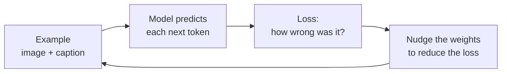
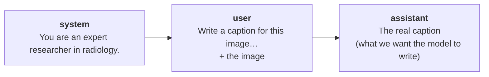
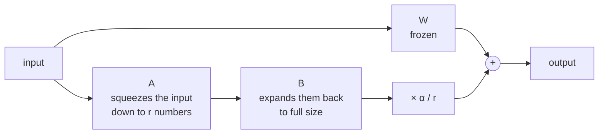
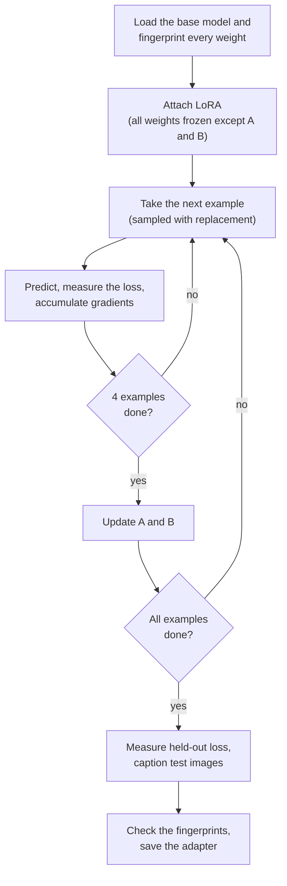
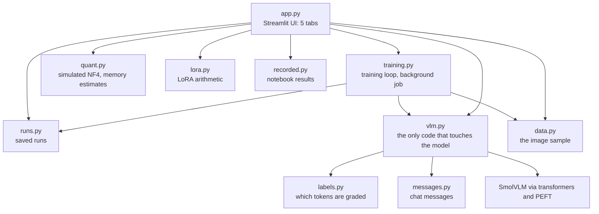

# How Adapter Tuning Works: a Beginner's Guide

This guide explains **adapter tuning** from the ground up and walks through every part of the
Adapter Tuning Explorer app. No machine-learning background is needed. If a word is unfamiliar,
check the [glossary](../GLOSSARY.md).

> **The 30-second version.** Training a large model from scratch costs a fortune. **Adapter tuning**
> starts from a model that already works, freezes almost all of it, and trains a small add-on (the
> *adapter*) on a small set of examples. You get a model adapted to your task for a tiny fraction of the
> cost. The catch is that a small adapter on a small dataset can learn to *sound* right well before
> it learns to *be* right, and a falling training loss won't tell you which one happened.

> **Learning tool only.** The captions in this app and guide can invent findings that are not in the
> image. Never use them for medical interpretation.

**How to read this guide.** Sections 2 to 6 follow the app's five tabs, in order. Each explains the
idea, shows a real example, points out the catch, and ends with things to try. Every number comes
from a real run unless it's marked as an estimate or as recorded from the notebooks.

Most numbers come from the **reference run**, which you can reproduce by clicking *Train the
reference run* in tab ④: 100 examples, `r=16`, `α=16`, learning rate 0.0002, seed 0. Two short runs
with the same seed gave identical losses on this machine, but results may differ a little on another.

---

## 1. The problem adapter tuning solves

### How a model is trained, in one paragraph

A model is a very long list of numbers called **weights**. To *train* it, you show it an example and
it predicts each next token (a **token** is a word or a piece of a word). You measure how wrong it was
with a single number, the **loss**. Then you nudge every weight slightly in the direction that would
have made the loss smaller, and repeat many times.



### Why not just train the whole model?

The reference notebooks use Gemma 3 4B, which has **4.3 billion** weights. Training all of them needs
a lot of memory and far more than 500 examples. With so many weights and so little data, the model
could simply memorise the examples.

There are three broad options:

| Option | What you train | Data you need | Cost |
|---|---|---|---|
| Use the model as it is | Nothing | None | Lowest, but it may not fit your task |
| **Adapter tuning** | A small part of the model | Hundreds of examples | Moderate |
| Fine-tune everything | All the weights | Far more | Highest |

The notebook itself says that 100 to 1,000 examples are usually enough for this kind of tuning.

### The task: captioning radiology images

The notebooks teach Gemma to write captions for medical scans in the style of a research paper. The
examples come from **ROCO** (Radiology Objects in COntext), a dataset of images and their captions taken
from published papers. Notebook 1 turns 65,450 of these into training messages.

### What this app does differently

The notebook trained on an NVIDIA L4 GPU with 32 GB of memory, for 42 minutes. That can't run on a laptop,
so this app does the same kind of training on a much smaller model, **SmolVLM-256M** (256 million weights),
and shows you the notebook's Gemma results as recorded reference data.
[ADR 0001](adr/0001-smolvlm-instead-of-gemma.md) records why, and [section 8](#8-where-the-app-differs-from-the-notebooks)
lists every difference.

> **What "base model" means in this guide.** The base model is whichever model is being adapted, so it depends
> on where you are. Everywhere in the app, and for every result this guide reports from a run, it's **SmolVLM
> before any training**. Gemma 3 4B is the notebook's base model, and it's always named when it appears.

---

## 2. Why tune, and the data (tab ①)

### The idea

Before training anything, look at two things: what the model writes today, and exactly what it will
be graded on.

### A real example from the app

Tab ① opens on `ROCO_00003`, a dental X-ray that the notebooks also use:

| Source | Caption |
|---|---|
| **Real caption** | Bacterial contamination occurred after completion of root canal treatment in the tooth, which remained with a temporary filling for 15 month. |
| **GPT-4o-mini** (recorded, notebook 2) | Radiographic image displaying the periapical region of tooth roots. The image highlights the presence of apical radiolucencies, indicative of potential periapical pathology. […] |
| **SmolVLM base model** (live) | [Black and white] [Image of a CT scan of the chest] |

Three things stand out:

- **GPT-4o-mini sounds convincing.** It's a much larger model, and the notebook's author calls its answer
  "pretty good". It's the **foundational model** here: a hosted general-purpose model used as a comparison.
- **The small base model struggles.** It doesn't write like a paper, and it calls a dental X-ray a chest CT.
  That gap is what we're trying to close.
- **The real caption can't be derived from the image.** A 15-month temporary filling can't be seen in an
  X-ray. It comes from the text of the paper. *No* model could get this right from the picture alone.

That last point matters more than it first appears, and we'll come back to it in
[section 6](#the-catch-sounding-right-is-not-being-right).

### One training example

Each example is three chat messages:



*Show the message* in the app displays this as JSON, in the same format the notebook writes to
`messages.jsonl`.

### What the model is actually graded on

The processor flattens those messages into one sequence of tokens. During training, the model predicts
each token from the ones before it. A parallel list called the **labels** says which predictions count:
a label of `-100` means "leave this one out of the loss".

The notebook's collator (the code that prepares each batch) masks only the padding and the image tokens.
Here is what that means for `ROCO_00003`, which has 133 tokens:

| Part | Tokens | Counted in the loss? |
|---|---|---|
| Image (64 slots and 3 markers) | 67 | No |
| Prompt (`System: You are an expert…` through `Assistant:`) | 40 | **Yes** |
| Caption | 26 | Yes |

So of the 66 tokens being graded, 40 (61%) are the prompt, and the prompt is **identical in every
example**. Remember this: it turns out to be the most important fact in this guide.

### The catch

Grading the prompt isn't obviously wrong, and it's how the notebook does it. But it gives the model an easy
way to reduce the loss without learning anything about radiology. Section 5 measures exactly how much.

### What to try

- Flip *Also mask the prompt from the labels* and watch the yellow tokens become struck through.
- Pick an example with a very short caption and see how much of the graded text is prompt.
- Click *Caption with the SmolVLM base model* on several images. How often does it get even the type of scan right?

---

## 3. Inside LoRA (tab ②)

### The idea

**LoRA** (Low-Rank Adaptation) is the most common way to do adapter tuning. A model is largely made of
**linear layers**, and each is essentially a big table of weights, a matrix **W**. An input goes in, gets
multiplied by W, and an output comes out.

LoRA freezes W and adds a correction beside it, built from two thin matrices, **A** and **B**:

```text
output = (W + (α / r) · B · A) · input
          │    └───────┬─────┘
       frozen    the adapter: the only part that trains
```



Three facts explain nearly everything about LoRA:

1. **It starts by changing nothing.** B starts at all zeros, so the correction is zero, and an untrained
   tuned model behaves exactly like the base model. Training can only move away from a model that
   already works.
2. **`r` limits how complicated the correction can be.** All information passes through a bottleneck of
   `r` numbers. In maths terms, the correction's *rank* can't exceed `r`, which is the "low-rank" in the name.
3. **`α / r` sets how strongly the correction applies.** It's a multiplier. If you raise `r` and leave `α`
   alone, the multiplier shrinks.

[Appendix A](#appendix-a-lora-by-hand) works through one multiplication by hand.

### Why this saves so much

A full matrix needs `inputs × outputs` weights. A and B together need only `r × (inputs + outputs)`. A real
example from the app, SmolVLM's `text_model.layers.0.self_attn.q_proj` at `r=16`:

| | Calculation | Weights |
|---|---|---|
| Full matrix W | 576 × 576 | 331,776 |
| A + B | 16 × (576 + 576) | 18,432 (5.6% of W) |

Across whole models at `r=16`:

| Model | Weights in linear layers | LoRA weights | LoRA as a share |
|---|---|---|---|
| SmolVLM 256M (this app) | 198,180,864 | 7,744,512 | 3.91% |
| Gemma 3 4B (the notebook) | 3,619,713,024 | 38,497,792 | 1.06% |

Gemma's numbers were counted from its published configuration without downloading its weights.

### The catch: the notebook's adapter isn't small

The notebook's configuration includes this:

```python
modules_to_save=["lm_head", "embed_tokens"]
```

That line tells PEFT to also train **full copies** of two very large layers: `embed_tokens` (which turns
tokens into numbers) and `lm_head` (which turns numbers back into token scores). In Gemma those are
671,252,480 weights each:

| What's trained in Gemma | Trainable weights |
|---|---|
| LoRA only | 38,497,792 |
| LoRA + `modules_to_save` | 1,381,002,752 |

So about **97% of what the notebook trains is those two layers**, not LoRA. That may be a sensible choice,
but it isn't the "tiny adapter" people usually picture. It's a good example of why it's worth counting the
trainable weights instead of assuming. Section 5 tests the setting on SmolVLM.

### What to try

- Turn off *After some training*. B and the correction go blank, and `W + correction` looks identical to W.
- Set `r` to 1 and then 8, and watch the caption's rank change. At `r=1`, every row of the correction is a
  multiple of the same pattern, which you can see as stripes.
- With `r` at 4, raise `α` and watch the correction get darker without changing its pattern.
- Pick `text_model.layers.0.self_attn.k_proj`, one of the smallest layers, and set `r` to 64. A + B reach 44% of W, so
  the saving shrinks when `r` is large relative to the layer.

---

## 4. QLoRA and memory (tab ③)

### The idea

LoRA shrinks what you *train*, but the entire base model must still fit in memory. **Quantization** shrinks
that: each frozen weight is stored in fewer bits, accepting a little rounding error. **QLoRA** is LoRA on a
quantized base model, and it's what the notebook uses.

> **This tab is a simulation.** The notebook uses a library called `bitsandbytes`, which isn't practical on a
> Mac, so the training in tab ④ is plain LoRA, not QLoRA. Tab ③ applies the same arithmetic to SmolVLM's
> real weights so that you can see what it does.

### Which 16 values?

Four bits allow only 16 different values. The method has two steps:

1. Split the weights into **blocks of 64**. In each block, divide by the largest absolute value, so that
   everything lands between −1 and 1.
2. Replace each value with the **nearest of 16 fixed levels**.

The question is where to put those levels. Real weights bunch up around zero, like a bell curve. **NF4**
(Normal Float 4-bit) places its levels close together near zero, where most weights are, and further apart
towards the edges.

### A real example from the app

Using `text_model.layers.0.mlp.down_proj.weight`:

| Levels | Average rounding error |
|---|---|
| NF4 | 0.01035 |
| Evenly spaced | 0.01239 |

NF4's error is about 16% lower with the same number of bits. The chart shows the weights as grey bars and
the two sets of levels as vertical lines. The spikes at exactly −1 and +1 aren't a mistake: each block's
largest weight becomes ±1 by construction.

### Double quantization

Each block also has to store its scale, the value it was divided by. At 32 bits, that adds a small cost to
every weight. **Double quantization** stores the scales themselves in about 8 bits:

| | Bits per weight |
|---|---|
| Normal 32-bit storage | 32 |
| NF4 | 4.5 |
| NF4 with double quantization | 4.127 |

[Appendix B](#appendix-b-quantization-by-hand) shows the arithmetic.

### What it means for Gemma

Estimated memory for Gemma 3 4B's weights:

| Setup | Weights in memory |
|---|---|
| All weights at 16 bits | 8.60 GB |
| 4-bit NF4 | 3.23 GB |
| + LoRA at `r=16` | 3.31 GB |
| + the notebook's `modules_to_save` | 5.99 GB |

### The catch

- **Only linear layers get quantized.** The embeddings stay at 16 bits, so the saving is less than a simple
  "4 bits instead of 16" suggests.
- **`modules_to_save` undoes much of the benefit.** It adds about 2.7 GB of trainable weights.
- **These are estimates from parameter counts.** They cover weights only. Real training also needs gradients,
  optimizer state and the batch, and PEFT may keep trainable weights at 32 bits, which would raise the last
  two rows. The notebook didn't record its actual memory use.

### What to try

- Choose different weight matrices. Does NF4 always win, and by how much?
- Toggle double quantization and watch the bits and the Gemma chart change.

---

## 5. Train an adapter (tab ④)

### The idea

This is the real thing. The app attaches LoRA to SmolVLM and trains it on radiology images on your machine.



### The controls

| Control | Default | What it does |
|---|---|---|
| Training examples | 60 | How many examples to train on. Each takes about 4 to 5 seconds on a laptop CPU. |
| Learning rate | 0.0002 | How big each nudge is. This is the notebook's value. |
| `r` | 16 | The size of the bottleneck (section 3). |
| `α` | 16 | With `r`, how strongly the correction applies. |
| Mask the prompt from the labels | Off | Off is what the notebook does. On grades only the caption. |
| `modules_to_save` | Off | **On is what the notebook does.** Also trains full copies of two large layers. |

`modules_to_save` is the one place where the default deliberately differs from the notebook, because leaving
it on would hide the small adapter this app is trying to show.

These stay fixed at the notebook's values: batch size 1, gradient accumulation 4 (weights update once every
4 examples), gradient clipping 0.3 (limits how big one update can be), dropout 0.05 (randomly ignores a few
values during training), and warmup 3% (the learning rate ramps up at the start).

### A real example: the reference run

| Measure | Result |
|---|---|
| Examples | 100, of which 60 were unique images (sampling repeats images) |
| Weight updates | 25 |
| Trainable weights | 7,744,512 of 264,229,440 (2.93%) |
| Where they are | Text decoder 4,884,480; vision encoder 2,654,208; connector 205,824 |
| Adapter on disk | 31 MB |
| Training time | 6.2 minutes, plus a few minutes to evaluate |
| Peak memory | 1.79 GB |
| Base weights changed | **0 of 471 tensors** |

That last row is the promise of adapter tuning, checked rather than assumed. The app takes a fingerprint of
every original weight before training and compares it afterwards.

### Reading the loss

Here's the main result. The reference run's loss, averaged over each 20 examples:

| Examples | Loss (what training minimises) | Prompt tokens only | **Caption tokens only** |
|---|---|---|---|
| 1–20 | 4.30 | 4.35 | **4.29** |
| 21–40 | 3.42 | 3.07 | **4.16** |
| 41–60 | 2.93 | 2.12 | **4.17** |
| 61–80 | 2.38 | 1.32 | **4.44** |
| 81–100 | 2.08 | 0.78 | **4.00** |

Looked at alone, the first column is a lovely curve: the loss halves. But nearly all of that drop comes from
the **prompt**, the same fixed sentence in every example. The model is memorising the instructions. The
caption loss, the part we actually care about, barely moves.

This is why the app records the two parts separately. [Appendix C](#appendix-c-what-a-loss-number-means)
translates these numbers into plain probabilities.

### Comparing with the notebook's Gemma run

The app overlays the loss recorded in notebook 3. Gemma's starts at 14.77, falls to around 4 to 5 by about
step 20, and then stays noisy through step 125, with no clear improvement after that.

The two runs can't be compared directly: the models, the image handling and the data all differ. The notebook
also doesn't separate prompt from caption, so we can't tell how much of *Gemma's* drop is the prompt. What we
can say is that the notebook's labels allow the same effect.

### The catch: testing the notebook's two settings

We ran the reference settings twice more, changing one thing each time:

| | Reference | Prompt masked | `modules_to_save` on |
|---|---|---|---|
| Trainable weights | 7,744,512 | 7,744,512 | 64,515,072 |
| Adapter on disk | 31 MB | 31 MB | 258 MB |
| Peak memory | 1.79 GB | 1.83 GB | 2.43 GB |
| Training time | 6.2 min | 6.5 min | 7.2 min |
| Final training loss (last 20) | 2.08 | 3.81 | 1.66 |
| **Held-out loss, SmolVLM base model** | 4.356 | 4.356 | 4.356 |
| **Held-out loss, SmolVLM tuned model** | **3.975** | **3.881** | **3.956** |

The **held-out loss** is measured on 30 images the adapter never saw, counting caption tokens only, so it's
the fairest number here. (Section 6 explains it.)

- **Masking the prompt:** the training loss looks much *worse* (3.81 against 2.08), yet the held-out loss is
  the best of the three. The bigger training loss is simply more honest.
- **`modules_to_save`:** an adapter 8 times larger, with the lowest training loss and almost no improvement in
  held-out loss over the reference.

These come from one seed and 30 images, so don't read too much into small differences. The solid conclusion
is the first: **training loss was a misleading guide in both directions.**

### What to try

Each run takes about 5 to 10 minutes, including evaluation. Runs are saved, so you can compare them later.

- Turn on *Mask the prompt* and compare the caption line with the reference run.
- Set `r` to 4. The adapter is a quarter of the size. Does the held-out loss suffer?
- Try a learning rate of 0.001. Does it learn faster, or does it become unstable?
- Turn on `modules_to_save`, then find the much bigger number under *Adapter on disk*.

> **Tip.** Training is CPU-heavy, and on an 8 GB laptop other open apps can slow it down a lot. Close what you
> can. Captioning is paused during training to leave it enough memory.

---

## 6. Test the adapter (tab ⑤)

### The idea

Training loss describes the examples the model studied. To find out whether it learned anything *real*, test
it on images it has never seen.

### Which model is which

This tab compares models, so it helps to know exactly what each label means:

| Label in the app | What it is | Where it comes from |
|---|---|---|
| **SmolVLM base model** | SmolVLM before any training | Run on this machine, with the adapter switched off |
| **SmolVLM tuned model** | The same SmolVLM weights with your adapter on top | Run on this machine, with the adapter switched on |
| **Gemma 3 4B tuned model** | The notebook's result, from a different and much larger model | Recorded in notebook 4, for one image only |

Two things follow from this:

- **Your training run never touched Gemma.** The "before and after" on this tab is SmolVLM before and after.
- **Gemma has no "before" here.** The notebook recorded no caption from Gemma before tuning, and no held-out loss
  either. So you can't measure how much tuning helped Gemma, and you can't compare the Gemma caption with the
  SmolVLM base model as if they were two stages of one model.

### Held-out loss

The reference run's held-out loss fell from **4.356 (SmolVLM base model) to 3.975 (SmolVLM tuned model)** over 30 test images. That's a real but
modest improvement: the probability the model gives each correct caption token rises from about 1.3% to about
1.9% on average ([Appendix C](#appendix-c-what-a-loss-number-means)).

Compare what the training loss suggested. It fell by about half, whereas the held-out caption loss fell by
about 9%.

### Captions side by side

The gallery, from the reference run:

| Image | Real caption | SmolVLM base model | SmolVLM tuned model |
|---|---|---|---|
| `ROCO_00001` | Axial MRI (coronal view). | A scan of an axial view of the brain shows a lesion in the right occipital lobe. | Posterior sagittal view of a patient with a right subdural hematoma. |
| `ROCO_00185` | Anteroposterior radiograph of pelvis at most recent follow up. | An X-ray of the pelvis shows a normal appearance with no fractures or abnormalities. | Posterior pelvic pain with a large lesion in the right lateral aspect of the pelvis. |
| `ROCO_00176` | Panoramic X ray taken four years later showing a unilocular radiolucent area in the left ramus. | An X-ray of a patient's teeth shows a full set of teeth with no signs of decay or other abnormalities. […] | Posterior view of the maxillary and mandibular teeth. |
| `ROCO_00031` | CTO of RCA (closure in the 2nd segment) | This image is a medical scan of a patient's chest X-ray. […] | Size 622 WT - 113 mm - 113 mm - 113 mm - 113 mm - […] |

The tuned captions **are** shorter and more like a paper's terse style, instead of the chatty "This image
is…". That's the adapter working. For comparison, notebook 4 recorded this from tuned Gemma, a different and much larger model, on `ROCO_00006`:
*"CT scan of the abdomen showing the size and density of the intra-abdominal mass."*

### The catch: sounding right is not being right

Read the table again, this time checking the facts:

- **It invents findings.** Nothing in the real caption for `ROCO_00001` mentions a hematoma, yet the tuned
  model states one with total confidence. In an early test run, a different adapter wrote "Liver scan showing
  hepatocellular carcinoma" for an abdominal scan whose real caption described tumor masses but never named a
  carcinoma. The SmolVLM base model invents things too (see its "lesion"), so tuning didn't create the problem. It
  *dressed the problem up in more convincing language*.
- **It latches onto a habit.** 9 of the 12 tuned gallery captions start with "Posterior", yet only 4 of the 100
  training captions contain that word at all. A likely explanation is that "Postoperative" begins 4 training
  captions, so the adapter boosted the token `␣Post`, and the base model tends to follow `␣Post` with `erior`.
  The table below shows that shift, though it doesn't prove the cause.
- **It can break down into repetition.** `ROCO_00031` above, and `ROCO_00006` ("…of the left lobe of the left
  lobe of the left lobe…").
- **The task itself has a limit.** As section 2 showed, many real captions contain facts that aren't in the
  image, such as "four years later". No model can learn to predict those from pixels, which puts a floor under
  how low the caption loss can go.

**So is this a failure?** It's a small model, on 100 examples, on a very hard task, and the point of this app is
to let you see what really happens. It does show the general lesson: **always evaluate on held-out data, and
read the outputs**. The notebook tests a single image and never compares it with Gemma's base model, so it wouldn't
reveal any of this.

### The adapter-strength slider

Because LoRA is literally `W + (α/r)·BA`, you can multiply the correction by anything you like. Strength 0 is
exactly the SmolVLM base model, which the test suite verifies, and strength 1 is the adapter as trained. For
`ROCO_00001`:

| Strength | Caption |
|---|---|
| 0.0 | A scan of an axial view of the brain shows a lesion in the right occipital lobe. |
| 0.2 | A grayscale MRI scan of the brain shows a lesion in the right occipital lobe. |
| 0.4 | A contrast-enhanced MRI scan of the left occipital lobe shows a lesion with a diameter of 4 mm. |
| 0.6 | Posterior axial view of a right occipital lobe with a lesion in the right occipital lobe. |
| 0.8 | Posterior sagittal view of a right occipital lobe with a right subdural hematoma. |
| 1.0 | Posterior sagittal view of a patient with a right subdural hematoma. |

You can watch the style change gradually, and the invented details change with it.

> If a run used `modules_to_save`, strengths between 0 and 1 scale only the LoRA part, not the two full copies.

### How the adapter shifts the next word

The app can compare the probabilities of the next token with the adapter off and on. For the first token of
`ROCO_00001`:

| SmolVLM base model | Probability | SmolVLM tuned model | Probability |
|---|---|---|---|
| `␣A` | 91.1% | `␣Post` | 25.9% |
| `␣An` | 6.8% | `␣A` | 4.7% |
| `␣Post` | 0.8% | `␣Epid` | 3.6% |
| `A` | 0.1% | `␣T` | 3.5% |
| `␣This` | 0.1% | `␣Diff` | 2.8% |

Two things have happened. `␣Post` went from 0.8% to 25.9%, and the SmolVLM base model's near-certainty about "A" is gone.
The adapter has spread the probability across many words that could plausibly begin a caption in a paper.

### What to try

- Move the strength slider from 0 to 1 in steps, on one image.
- Move *Tokens written so far* along a caption, and find where base and tuned most disagree.
- Compare the reference run with a prompt-masked run on the same images.
- Open the gallery and, for each tuned caption, list which claims are supported by the real caption.

---

## 7. How the app is built



**Design choices worth knowing:**

- **`vlm.py` is the only place that talks to the model.** The other modules work on plain numbers and ids,
  so most of the logic can be tested in seconds.
- **The training loop is hand-written** ([ADR 0002](adr/0002-custom-training-loop.md)). The notebook's `SFTTrainer`
  hides the per-step values this app needs, such as the split between prompt and caption loss.
- **Training runs in a background thread**, because Streamlit restarts the script whenever you touch a control.
- **The live chart refreshes only every 10 seconds.** Redrawing competes with training for the CPU: when it
  refreshed every 2 seconds, training slowed by about 3 times.

---

## 8. Where the app differs from the notebooks

| Notebook | The app | Why |
|---|---|---|
| Gemma 3 4B (4.3B weights) | SmolVLM 256M (256M weights) | Fits on an 8 GB laptop, with no license to accept |
| 32 GB NVIDIA L4 GPU | Laptop CPU | The app should run on a laptop. MPS crashed in testing |
| QLoRA: 4-bit NF4 with `bitsandbytes` | Plain LoRA, with NF4 simulated in tab ③ | `bitsandbytes` isn't practical on a Mac |
| `bfloat16` | `float32` | CPU training |
| 500 examples, 125 updates | 100 examples and 25 updates in the reference run | About 6 minutes instead of 42 |
| Sampled from all 65,450 examples | Sampled from the first 100 rows | Small download |
| `modules_to_save` always on | Toggle, off by default | Shows the small adapter (section 5) |
| Prompt always in the labels | Toggle, in the labels by default | Same default, so its effect can be measured |
| `SFTTrainer` | Small custom loop | Records every step (ADR 0002) |
| 256 image tokens per image (Gemma) | 64 image tokens, one 512 × 512 view | SmolVLM's format, and a faster step |
| Collator masks by specific token ids | Masks SmolVLM's own image tokens | Same purpose, different model |
| Sampling with temperature 0.8, up to 256 tokens | Greedy, up to 80 tokens | Same image gives the same caption, so comparisons are fair |
| No held-out evaluation | Held-out loss on 30 images, and a gallery of 12 | Training loss alone misleads (section 5) |
| GPT-4o-mini called live | Its recorded caption | No API keys or cost |
| Saved to the Hub (`push_to_hub=True`) | Saved locally in `runs/` | Nothing leaves your machine |

### Things worth noticing in the notebooks

These aren't necessarily mistakes. The notebooks closely follow Google's published tutorial, and they're
written to teach the pattern. But each one is instructive:

1. **The prompt counts towards the loss.** Section 5 measured how much this matters on SmolVLM.
2. **`random.choices` samples with replacement.** The notebook's 500 "examples" can include duplicates. In our
   reference run, 100 draws from 100 images gave 60 unique images. The notebook's pool is far larger, so it would
   have far fewer repeats.
3. **There's no held-out evaluation.** The test is one image, and it's never compared with Gemma's base model.
4. **The adapter isn't small.** `modules_to_save` makes up about 97% of the trainable weights (section 3).
5. **The loss plateaus early.** It reaches about 4 to 5 by around step 20 of 125.
6. **The model and processor come from different checkpoints.** The model is `gemma-3-4b-pt`, while the
   processor comes from `gemma-3-4b-it`.

---

## Appendix A: LoRA by hand

Take the smallest possible layer, with 2 inputs and 2 outputs, and `r=1`, `α=2`:

```text
W = [ 1  0 ]     A = [ 0.5  0.5 ]     B = [  0.2 ]     input x = [ 1 ]
    [ 0  1 ]                              [ -0.4 ]               [ 2 ]
```

**Step 1: the frozen path.** W happens to be the identity, so `W · x = [1, 2]`.

**Step 2: squeeze.** A turns the 2 inputs into `r = 1` number: `A · x = 0.5×1 + 0.5×2 = 1.5`.

**Step 3: expand.** B turns that one number back into 2 outputs: `B · 1.5 = [0.3, −0.6]`.

**Step 4: scale.** `α / r = 2 / 1 = 2`, which gives `[0.6, −1.2]`.

**Step 5: add.** `[1, 2] + [0.6, −1.2] = [1.6, 0.8]`.

Training only ever changes A and B. W stays as it was.

**Why the correction is limited.** Everything passes through the single number from step 2, so the correction
always points the same way, along `[0.2, −0.4]`. Only its length changes. That's what rank 1 means, and it's why a
larger `r` can express more.

**Why it starts at zero.** If B were `[0, 0]`, step 3 would give `[0, 0]` whatever A was, so the output would be
exactly `W · x`.

---

## Appendix B: quantization by hand

**Rounding one weight with NF4.** Suppose a weight of 0.1 is in a block whose largest absolute value is 0.5.

1. **Scale it:** `0.1 / 0.5 = 0.2`.
2. **Find the nearest NF4 level.** The two closest are 0.16093 and 0.24611, and 0.16093 is nearer.
3. **Store** the level's 4-bit index. To use the weight, multiply back: `0.16093 × 0.5 = 0.0805`.

The rounding error is `0.1 − 0.0805 = 0.0195`. All the positive and negative levels:

```text
−1.000  −0.696  −0.525  −0.395  −0.284  −0.185  −0.091  0.000
 0.080   0.161   0.246   0.338   0.441   0.563   0.723  1.000
```

The gaps are small near zero (about 0.09) and large near the edges (about 0.30).

**Where 4.5 and 4.127 come from.**

- Each block of 64 weights has one 32-bit scale: `4 + 32/64 = 4.5` bits per weight.
- With double quantization, each scale takes 8 bits, and each group of 256 scales shares one 32-bit
  scale of its own: `4 + (8 + 32/256)/64 = 4.127` bits per weight.

**Where Gemma's 3.23 GB comes from.**

```text
Linear layers:  3,619,713,024 weights × 4.127 bits ÷ 8 = 1.87 GB
Everything else:  680,366,448 weights × 16 bits   ÷ 8 = 1.36 GB
                                                 Total: 3.23 GB
```

---

## Appendix C: what a loss number means

The loss here is **cross-entropy**. For one token, it's the negative log of the probability the model gave to the
correct token. So `probability = e^(−loss)`.

Averaged over many tokens, this gives the typical probability given to each correct token (strictly, the geometric
mean):

| Loss | Typical probability of the right token | Where it appears in this guide |
|---|---|---|
| 4.356 | 1.3% | Held-out, SmolVLM base model |
| 4.29 | 1.4% | Reference run, caption tokens, first 20 examples |
| 4.00 | 1.8% | Reference run, caption tokens, last 20 examples |
| 3.975 | 1.9% | Held-out, reference adapter |
| 3.881 | 2.1% | Held-out, prompt-masked adapter |
| 2.08 | 12.5% | Reference run, overall, last 20 examples |
| 0.78 | 45.8% | Reference run, prompt tokens, last 20 examples |

This makes the story clear:

- By the end, the model gives the next **prompt** token about a 46% chance, because it has been memorising a
  fixed sentence.
- It gives the next **caption** token only about a 2% chance. Captions really are hard to predict: there are
  around 49,000 possible tokens, and the text depends on facts that often aren't in the image.
- A held-out fall from 4.356 to 3.975 means the right token is about **1.46 times** as likely (`e^0.381`). That's real
  progress, though it's far less impressive than a training loss that halves.

---

## Appendix D: the notebooks, cell by cell

### Notebook 1: `1_prepare_data.ipynb`

| Cells | What they do | In this project |
|---|---|---|
| 0–1 | Explain ROCO and how to download it from Kaggle | `adapter_lab/data.py` downloads a sample from a mirror instead |
| 3–7 | Unzip, look at the CSV, display two images | Tab ①, image and real caption |
| 9 | `format_message`: builds the three chat messages | `adapter_lab/messages.py`, same prompts |
| 10–12 | Read the CSV, try the format on 3 rows | Tab ①, *Show the message* |
| 14–17 | Write all 65,450 examples to `messages.jsonl` | `data/train.jsonl` and `data/test.jsonl`, 100 rows each |

### Notebook 2: `2_foundational.ipynb`

| Cells | What they do | In this project |
|---|---|---|
| 2–5 | Load the OpenAI key and messages | Not needed |
| 8 | Build inputs for the hosted model | Not needed |
| 9 | Caption `ROCO_00003` with GPT-4o-mini | Tab ①, recorded in `adapter_lab/recorded.py` |
| 10 | "Pretty good… let's train a smaller model" | The motivation for the app. Our live baseline is SmolVLM |

### Notebook 3: `3_adapter_tuning.ipynb`

| Cells | What they do | In this project |
|---|---|---|
| 3–5 | Load the Hugging Face token and messages | Not needed: SmolVLM isn't gated |
| 7 | `process_vision_info`: read images as RGB | `read_image` in `vlm.py` |
| 9 | Load Gemma in 4-bit NF4 | `CaptionModel` in `vlm.py` (no quantization). NF4 is simulated in `quant.py` and tab ③ |
| 11 | `LoraConfig` | `make_lora_config` in `vlm.py`, with `modules_to_save` optional. Tab ② explains it |
| 12 | `SFTConfig` | The constants and `TrainConfig` in `training.py` |
| 12 | `collate_fn`: build labels | `labels.py` and `labels_for` in `vlm.py`. Tab ① shows the result |
| 14 | `SFTTrainer`, sampling 500 examples, training | `train` in `training.py`. Tab ④ |
| 14 | The loss log | `GEMMA_LOSS` in `recorded.py`. Tab ④ overlay |

### Notebook 4: `4_test_model.ipynb`

| Cells | What they do | In this project |
|---|---|---|
| 3 | `process_vision_info` | `read_image` |
| 5–6 | Choose the test image `ROCO_00006` | The default image in tab ⑤ |
| 7 | Load the model with its adapter | `CaptionModel(adapter_dir)` |
| 8 | `format_message` without the answer | `format_message(path)` |
| 9 | `generate_description`, sampling at temperature 0.8 | `caption` in `vlm.py`, greedy |
| 9 | One recorded tuned caption | `GEMMA_TUNED_CAPTION`. Tab ⑤ gallery |

### Running the real thing on a GPU

The app has no Gemma mode, but you can run the notebooks themselves:

1. **Accept the license.** Visit [`google/gemma-3-4b-pt`](https://huggingface.co/google/gemma-3-4b-pt) and agree to
   Google's terms. Access is per account, and your token won't work until you've done this.
2. **Create a token with write permission**, and put it in `keys.env` as `HF_TOKEN`. Write access is needed
   because the notebook sets `push_to_hub=True`.
3. **Get a suitable machine.** The notebook used a 32 GB NVIDIA L4. `bitsandbytes` 4-bit needs a GPU, and the code
   checks for `bfloat16` support.
4. **Get the data.** Set up [Kaggle API access](https://www.kaggle.com/docs/api#authentication) and download the
   dataset as notebook 1 describes. Leave plenty of disk space: the Hugging Face mirror's training split alone is
   roughly 13 GB.
5. **Run notebooks 1, 3 and 4.** Notebook 2 is optional and needs an `OPENAI_API_KEY`. Expect notebook 3 to take
   about 42 minutes on similar hardware.

To apply what this guide found, consider adding an `eval_dataset`, masking the prompt in `collate_fn`, and comparing
base and tuned captions on many images, not just one.
